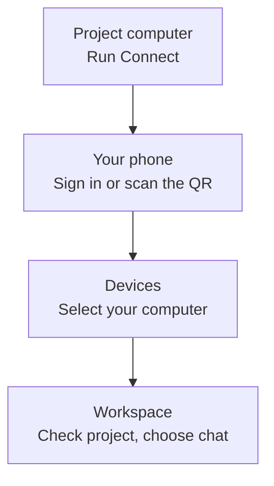

Use a connected computer's project from another Kisuke client. The computer provides the files, terminal environment, and agent runtime; the client lets you work with them. Start by making that computer available, then choose its project.

Pairing a phone signs it into your Kisuke account. Opening a workspace is a separate step: Kisuke still needs a usable connection to the computer and access to the selected folder.

To share provider connections and supported user-level tools between computers, configure [Device Sync](/workspace/device-sync). Its data choices are separate from pairing and opening a remote project.

## From desktop to phone

Keep the project on its computer and use your phone to open that workspace. The path is:

If your phone is already signed in, go straight to [choosing the computer and project](#on-your-phone). To resume existing work, select the conversation from its chat list after opening the workspace. Follow the [Zen desktop-to-phone walkthrough](/zen-mode#continue-on-your-phone) to check the conversation, send a focused follow-up, and return to desktop.

## Prepare the computer

1. [Install Kisuke](/get-started/install) on the computer that contains your project, open it, and sign in.
2. Complete [Connect setup](/get-started/desktop-setup#set-up-connect). Connect is the background service that handles work on the computer.
3. [Open the project folder](/projects/open-a-project) on that computer and confirm its contents.
4. Connect the [AI provider](/models/providers) you intend to use and check the available harness and model for the project.
5. Keep the computer awake, connected to the network, and running Connect while accessing it remotely.

On desktop, **Settings → Connect** shows the latest reported local service status. **Running** alone does not establish that another device can reach it. See [Stop and restart Connect](#stop-and-restart-connect) when you want to stop access through that computer's service.

## Pair your phone

You need a signed-in desktop app and Kisuke installed on your phone. Use the mobile links on the [downloads page](https://kisuke.dev/downloads/) if you need the phone app. The in-app scanner is on the phone's sign-in screen.

<Steps>
  <Step title="Display the pairing code">
    On desktop, open **Settings → Devices** and choose **Pair a phone**. You can also use the **Pair your phone** step during desktop setup.
  </Step>
  <Step title="Scan from your phone">
    On the phone's sign-in screen, choose **Scan QR from Desktop**. Allow camera access when prompted, then point the camera at the current desktop QR code.

    You can also scan with the phone's camera app. If the link opens a pairing webpage, use **Already have Kisuke? Open it**. If you still need to install the app, return afterward and scan the current code again.
  </Step>
  <Step title="Check the result">
    The scanner shows **Linking your phone…** while signing in. The desktop panel shows **Phone linked** when it receives confirmation. Complete any remaining setup on the phone, then open **Devices** and choose the computer you want to use.
  </Step>
</Steps>

The QR code grants sign-in to your account. Scan it with your own phone and keep it out of shared screenshots. Use the live code on desktop; an old capture may have expired.

If your phone is already signed in, open **Devices** directly. Pairing is not a control for switching the computer used by an existing workspace.

### Resolve a pairing problem

<AccordionGroup>
  <Accordion title="The phone cannot scan the code">
    For **Camera access needed**, choose **Open Settings**, enable camera access for Kisuke, and return to try again. For **No camera available**, use a device with a working camera. The iOS simulator cannot perform this camera workflow.

    If the camera app opens a webpage instead of Kisuke, try the page's **Already have Kisuke? Open it** link or scan from **Scan QR from Desktop** in the installed app.
  </Accordion>
  <Accordion title="The code expired or was cancelled">
    Keep the desktop pairing panel open and scan its current code. The panel refreshes an expired code. If it shows **Code cancelled**, choose **Generate new code**.

    For **Couldn't generate a code**, check the desktop's sign-in and network connection, then choose **Try again**. A code generation failure happens before the phone can complete pairing.
  </Accordion>
  <Accordion title="The phone reports a linking error">
    Read the error, confirm both devices have network access, and try the current desktop code again. If a link opened directly into the app fails, Kisuke can show **Pairing failed**.

    A successful sign-in does not confirm that a computer is available. Continue with the device checks below if the phone is signed in but has no workspace to open.
  </Accordion>
</AccordionGroup>

## Choose where to work

### On desktop or web

Use **Open project** or **Open folder**, then choose the computer in **Browse Folders**. Enter or browse to the path on that computer and choose **Open**. See [Open a project](/projects/open-a-project) for folder creation and navigation.

**Settings → Devices** is an inspection screen. Selecting a device there changes the displayed system statistics; it does not switch the project behind your conversation.

### On your phone

Open **Devices** and select an available computer. Kisuke can return you to a remembered workspace or open the workspace screen for project selection. Confirm the destination project and computer before acting, especially if your preferred project is unavailable.

To continue an existing conversation, open **Chat**, tap **Show chat list**, and select its title. Follow [Find and resume on your phone](/conversations/find-conversations#find-and-resume-on-your-phone) for project browsing, title search, and older entries. Opening a workspace does not by itself select the chat you wanted to resume.

On iPad or an Android tablet, a large enough app window opens the [tablet Zen workspace](/zen-mode#use-zen-on-a-tablet). Use its chat list and **Open tools** control to work with the conversation and project tools.

The connection details distinguish these states:

| State | Meaning and next step |
| --- | --- |
| **Ready** | A usable connection is available. Open the workspace and check the project. |
| **Connecting** | The computer is visible, but its connection is not ready. Let it finish connecting. |
| **Recovering** | Kisuke is recovering the connection. Wait for readiness before retrying an action. |
| **Offline** | Kisuke has no usable connection and cannot see this computer online. Check the computer and network. |

If opening a device reports **This location is not ready yet** or says the device is reconnecting, return to **Devices**, use the refresh button or pull to refresh, and inspect the new state before opening it again.

Long-press a device row to inspect **Connection details**. The account menu also offers **Connection details** for known devices. A ready route can be labeled **Direct (local network)** or **Relay**; a separate relay status alone does not tell you whether a direct route is usable.

## Check the first interaction

After opening a remote project, verify the destination with a small action before making changes:

1. Open **Files** on desktop or web, or **Editor** on your phone, and read a familiar file such as the README. See [Files and the editor](/workspace/files) for browsing controls.
2. Open a [terminal](/workspace/terminal) if needed and check its working directory. Wait for the terminal to accept input before sending commands.
3. Confirm the selected [harness, provider, and model](/models/overview), then ask it to explain that file without editing.

Check the project again after reconnecting or switching computers. A visible old transcript, terminal buffer, or file preview does not establish that new operations can reach the destination.

For a remote development server, use the workspace's [browser and port controls](/workspace/browser). The project computer and the device displaying the browser can be different machines.

## Sign out of your phone or tablet

Use **Sign out** to end the session in that mobile app:

1. Open **Devices**.
2. Tap your account picture or icon, labeled **Account options**.
3. Choose **Sign out**. Kisuke returns to its sign-in screen and closes that client's workspace connections.

This clears the mobile app's saved sign-in and profile information when cleanup succeeds. It does not sign out your other devices or stop Connect on the project computer.

If **Sign Out Failed** appears, record the error for support. The sign-in screen can appear before cleanup finishes, so that screen alone does not confirm that the saved sign-in was removed.

To return, sign in again or [scan a current desktop pairing code](#pair-your-phone). Then choose the computer and check the project before resuming work.

## Stop and restart Connect

Use this when you want to stop the project computer's Connect service. It affects clients using that service, including other devices working with the same computer. Finish or stop active work first.

1. On the project computer, open **Settings → Connect**.
2. Choose **Stop** to stop the service.
3. To make the computer available again, use **Start** in the same panel.
4. On the connecting client, refresh **Devices**, wait for a usable connection, and [check the first interaction](#check-the-first-interaction) in the intended project.

If the panel keeps showing its previous status or starting fails, use **Open Logs** and record the error before repeating the action. The control finishing its loading state does not by itself confirm a successful stop or start.

## Diagnose missing or unavailable devices

### No devices appear

Check that the client and project computer are signed into the intended Kisuke account. On the computer, inspect **Settings → Connect**; on the client, refresh **Devices** and read any error.

**No devices yet** or **No devices found** is not enough to diagnose a stopped service. Discovery can fail while a local project still works. If you also see **Failed to load devices**, keep that error and check sign-in and connectivity before restarting Connect.

### The device appears but its workspace will not open

Check the connection details and the target folder. Discovery, route readiness, and access to a project are separate checks. A listed computer can still be connecting, recovering, or missing the requested folder.

If the phone says the device has not finished loading its projects, refresh **Devices**. On a loading recovery screen, use **Try again**, or **View devices** to inspect the connection. Let the project list load. Avoid creating another project or resending a prompt simply because the previous result has not appeared. Inspect the original project or conversation once the connection returns.

### Live statistics are unavailable

On desktop, **Settings → Devices** can show CPU, memory, network, uptime, and resource counts for the selected computer. **Live route unavailable** means the statistics screen does not have a usable route. A retained device entry is not a current measurement.

Sampling can pause while the app is in the background, so **Idle** alone does not mean Connect stopped. Return to the screen and check its connection state. CPU and memory statistics help inspect the computer; they do not confirm that a particular model or prompt is ready.

### Several workspace tools fail together

If chat, Files, Git, terminal, and browser operations all stop reaching the same computer, check that shared connection first. Keep the device awake and confirm Connect is running. Once the connection recovers, confirm the project and inspect each operation's result before repeating anything that could change files or run a command.

If you need help, record the exact message, affected computer, time, and whether the failure affects one tool or the whole workspace. On mobile, inspect **Connection details**. Review diagnostic reports for private paths or account information before sharing them.

Continue in [Zen mode](/zen-mode), or use [first-message troubleshooting](/help/starting-a-chat) when the project opens but a response cannot start.
